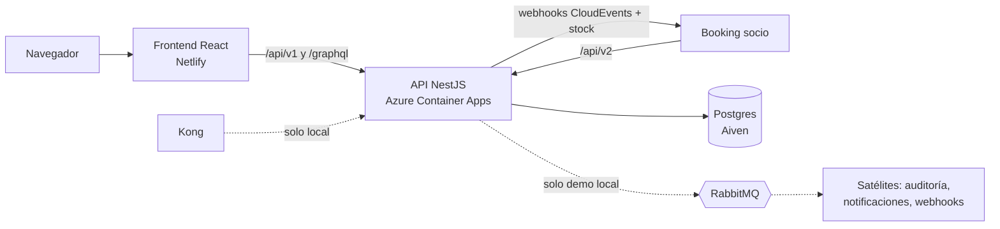

# RAM Alliance · Sistema de venta de vuelos

Sistema de venta de vuelos del proyecto de Integración de Sistemas: **núcleo GDS** (búsqueda, holds, reservas, billetes, posventa, check-in, webhooks) + **e-commerce** (identidad, ofertas, pagos simulados, órdenes) + **API v2 para Booking** + **panel admin** + **trazabilidad**. Backend NestJS 10 + TypeORM + PostgreSQL; frontend React. Rama de trabajo: `vuelos`.

## Arquitectura



Línea continua = producción. Línea punteada = solo local / demo de microservicios.

## Componentes

| Componente | Carpeta | README |
|---|---|---|
| Módulo Vuelos (núcleo GDS, v2, gateway GraphQL, ESB) | `src/modules/vuelos/` | [README](src/modules/vuelos/README.md) |
| E-commerce (órdenes, pagos, admin, BFF, trazabilidad) | `src/modules/vuelos/ecommerce/` | [README](src/modules/vuelos/ecommerce/README.md) |
| Código raíz del backend y satélites | `src/` | [README](src/README.md) |
| Frontend React | `frontend/` | [README](frontend/README.md) |
| Contratos (OpenAPI, eventos, socios) | `contracts/` | [README](contracts/README.md) |
| Despliegue (Azure, Kong) | `deploy/` | [README](deploy/README.md) |
| Imágenes de la demo de microservicios | `docker/` | [README](docker/README.md) |
| Scripts de contratos, modelo y smoke | `scripts/` | [README](scripts/README.md) |
| Volcado SQL de referencia | `database/` | [README](database/README.md) |
| CI y publicación de imagen | `.github/workflows/` | [README](.github/workflows/README.md) |
| Documentación (planes, auditorías, guías) | `src/modules/vuelos/docs/` | [README](src/modules/vuelos/docs/README.md) |

## Entornos reales

| Pieza | Dónde |
|---|---|
| API | **Azure Container Apps**, `westus`, 1 réplica máx., `minReplicas 0` (duerme sin tráfico) |
| Imagen | GHCR, construida por `container.yml`, etiquetada con el sha; se despliega con `deploy/azure/desplegar.sh` |
| Base de datos | Aiven (Postgres con TLS, CA privada: `DB_SSL_CA`) |
| Frontend | Netlify |
| Railway / Neon | **Ya no se usan** |
| Kong, RabbitMQ, satélites | Solo local / demo |

## Puesta en marcha local

```bash
npm install
docker compose up -d        # Postgres 16; puerto 5432 en docker-compose.yml
npm run start:dev           # API en :3000 (synchronize crea el esquema)
npm run seed:vuelos         # vuelos, tarifas, mercado, aeropuertos (ADMIN_EMAIL + ADMIN_PASSWORD crean un admin)
cd frontend && npm install && npm run dev    # Vite en :5173
```

- Necesitas `.env` con `JWT_SECRET` (≥ 32 caracteres) y `DATABASE_URL`; ver `.env.example`.
- Si el 5432 está ocupado, hay un `docker-compose.override.yml` local que publica Postgres en **5433**; entonces `DATABASE_URL` debe usar 5433.
- Swagger: `http://localhost:3000/api/docs` (v2: `/api/docs-v2`).
- Gateway Kong local: `docker compose --profile gateway up -d kong` → `:8000` (ver [deploy/gateway](deploy/gateway/README.md)).

**Demo de microservicios** (núcleo + 3 satélites + RabbitMQ + Kong + frontend; Kong en `:8000`, frontend en `:8080`):

```bash
npm run micro:build && npm run micro:up && npm run micro:smoke
npm run micro:down          # -- -v borra también el volumen
```

Necesita `docker/.env.microservicios` (parte de `docker/.env.microservicios.example`).

## Calidad

| Comando | Qué comprueba |
|---|---|
| `npm run lint` | ESLint, debe quedar en 0 errores |
| `npm test` | Unitarios; con `TEST_DATABASE_URL` también integración |
| `npm run build` | Compila (specs incluidos) |
| `npm run contract:events:check` | Esquemas de eventos compatibles hacia atrás |
| `npm run contract:v2:build` | Regenera nuestro contrato v2 |
| `npm run contract:export` | Regenera el OpenAPI de todo el sistema (`OPENAPI_URL`) |

## Contratos

| Contrato | Archivo |
|---|---|
| v1 GDS (escrito a mano) | `contracts/vuelos-openapi.yaml` |
| v2 plantilla de Booking (no se edita) | `contracts/vuelos-openapi-v2.yaml` |
| v2 propio (generado) | `contracts/vuelos-openapi-v2-ram-alliance.yaml` |
| E-commerce (generado) | `contracts/vuelos-ecommerce-openapi.yaml` |
| Eventos | `contracts/eventos/` + `contracts/vuelos-eventos-asyncapi.yaml` |
| Socios (Alojamientos, Autos, Atracciones) | `contracts/socios/` |

Detalle en [contracts/README.md](contracts/README.md).

## Mapa de navegación

**(a) Cuaderno semanas 7-11** (cuaderno: [RETO-2-CORTO.md](src/modules/vuelos/docs/RDA2-docs/auditorias/RETO-2-CUADERNO/RETO-2-CORTO.md))

| Semana · tema | Carpetas y README |
|---|---|
| S7 · contratos | [contracts/](contracts/README.md), [vuelos/common](src/modules/vuelos/common/README.md) |
| S8 · gateway | [deploy/gateway](deploy/gateway/README.md), [vuelos/gateway](src/modules/vuelos/gateway/README.md), [ecommerce/bff](src/modules/vuelos/ecommerce/bff/README.md) |
| S9 · pruebas | [vuelos/testing](src/modules/vuelos/testing/README.md), [.github/workflows](.github/workflows/README.md) |
| S10 · observabilidad | [ecommerce/observabilidad](src/modules/vuelos/ecommerce/observabilidad/README.md), [vuelos/common](src/modules/vuelos/common/README.md) |
| S11 · seguridad | [vuelos/auth](src/modules/vuelos/auth/README.md), [vuelos/v2](src/modules/vuelos/v2/README.md), [vuelos/common](src/modules/vuelos/common/README.md) |

**(b) Auditorías C01-C14** → todas en [auditorias/README.md](src/modules/vuelos/docs/RDA2-docs/auditorias/README.md).

## Más documentación

- [CLAUDE.md](CLAUDE.md): descripción técnica vigente del sistema.
- [HEURISTICAS-NIELSEN.md](src/modules/vuelos/docs/RDA2-docs/HEURISTICAS-NIELSEN.md)
- [CONTENEDORES-POR-MICROSERVICIO.md](src/modules/vuelos/docs/RDA2-docs/CONTENEDORES-POR-MICROSERVICIO.md)
- [Planes de implementación](src/modules/vuelos/docs/planes/README.md)
