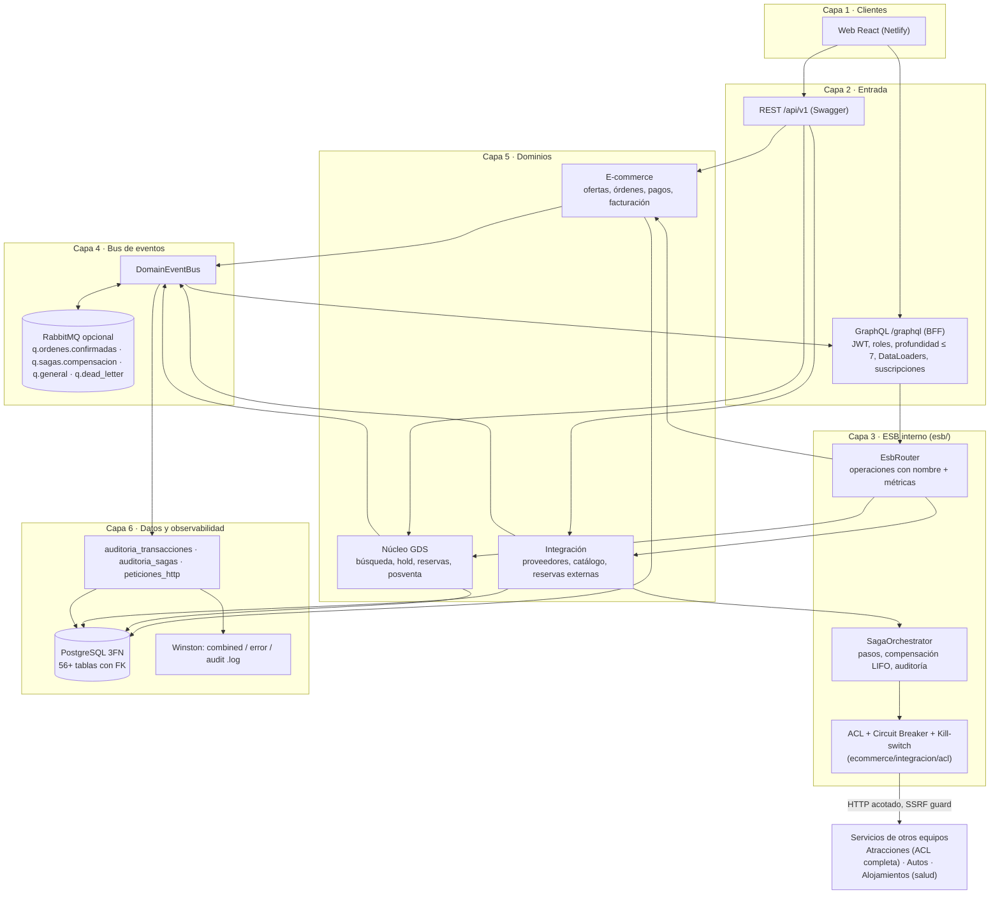

# Arquitectura por capas — Vuelos

Adaptación del diagrama de referencia (`mermaid_20261021_28f8d5`) al sistema real. Es **un solo despliegue** (monolito modular de Nest) con fronteras de capa claras; lo que el diagrama separa en servicios aquí son módulos que se pueden separar después. Esta página dice qué está implementado, dónde vive y qué se dejó para una fase siguiente. El diagrama visual equivalente, con las 7 capas del original y lo pendiente marcado con trazo punteado, es [`arquitectura-completa-vuelos.svg`](arquitectura-completa-vuelos.svg) (versión PNG: `arquitectura-completa-vuelos-HD.png`; fuente editable en el mismo formato que la referencia: [`arquitectura-completa-vuelos.mermaid`](arquitectura-completa-vuelos.mermaid)); ambos se generan a partir de esta misma información.

## Qué hay en cada capa

| Capa | Implementado | Dónde |
|---|---|---|
| Entrada REST | Todas las rutas del contrato GDS, e-commerce, administración y proveedores | `vuelos.controller.ts`, `ecommerce/**/*.controller.ts` |
| Entrada GraphQL (BFF) | `catalogoUnificado`, `misReservas`, `facturaCompleta`, `saludNodos`, `auditoriaTransacciones`, `auditoriaSagas`; mutaciones `checkoutExterno`, `cancelarReservaSaga`, `checkInDigital`; suscripción `estadoReservaCambiado` (graphql-ws). Mismos errores con `extensions.code` que REST | `gateway/` |
| ESB | `EsbRouter` (cada operación del gateway pasa por aquí y se mide como `ESB <operación>`), `SagaOrchestrator` genérico | `esb/` |
| ACL | `ClienteProveedor` (SSRF, tiempo y tamaño acotados), `AdaptadorProveedor` por tipo (Atracciones completo; Autos y Alojamientos solo salud), circuit breaker por proveedor (opossum), kill-switch (`proveedores.activo`) | `ecommerce/integracion/acl/` |
| Orquestadores | Reserva externa (autorizar → reservar en el socio → verificar precio → confirmar y facturar → capturar) sobre `SagaOrchestrator`. La saga de compra de vuelos conserva su propia implementación con el mismo registro de pasos (`SagasRegistroService`) | `ecommerce/integracion/reservas-externas.service.ts`, `ecommerce/ordenes/compras.service.ts` |
| Bus | `DomainEventBus` en proceso; con `RABBITMQ_URL` pasa por RabbitMQ (exchange `booking.events`, colas por tipo de evento, 3 reintentos y `q.dead_letter`). Si el broker cae, se entrega en proceso: nunca se pierde un evento | `common/domain-event-bus.ts`, `esb/rabbitmq.transport.ts` |
| Consumidores | Auditoría de eventos (idempotente por id de evento), notificaciones, facturación (se emite en la transacción de la orden), reconciliación, pasarela de suscripciones GraphQL | `ecommerce/observabilidad`, `gateway/gateway.pubsub.ts` |
| Datos | PostgreSQL en 3FN con FK, migraciones con relleno de datos | `migrations/`, `docs/MODELO-DE-DATOS.md` |
| Observabilidad | Auditoría de eventos y sagas en BD, bitácora acotada de peticiones con purga, logs Winston con `correlationId`, métricas de proceso, salud de proveedores cada 60 s | `ecommerce/observabilidad`, `common/winston-logger.ts` |

## Variables de entorno de esta arquitectura

`RABBITMQ_URL` (vacío = bus en proceso), `GRAPHQL_MAX_DEPTH` (7), `LOG_DIR`, `LOG_TO_FILES`, `HTTP_LOG_RETENTION_DAYS`, `PROVEEDORES_*` (ver `.env.example`). La introspección de GraphQL se apaga con `NODE_ENV=production`.

## Decisiones y diferencias con el diagrama de referencia

- **Un despliegue, no microservicios.** Los límites de capa son módulos de Nest. Separar un dominio en su propio servicio significa mover su módulo y hablarle por el ESB/bus, que ya es la única puerta.
- **RabbitMQ es opcional** (variable de entorno): sin él todo funciona igual. Producción puede usar CloudAMQP (plan gratuito) o un servicio RabbitMQ en Railway.
- **Logs en BD acotados**: el diagrama pedía «cero logs de red en BD». Se implementó una muestra pequeña (`peticiones_http`, purga a los 7 días) para consultas rápidas; el registro completo son los archivos Winston.
- **Fuera de alcance (fase siguiente):** Kafka y su puente, microservicio de ingesta de stock por gRPC, orquestador de paquetes dinámicos, app móvil, y un esquema de Postgres por dominio (hoy todo comparte base; los tests aíslan cada suite con su propio esquema).
- La saga de compra de vuelos no se migró al orquestador genérico para no tocar el camino de cobro ya probado; sí comparte su registro de pasos.
