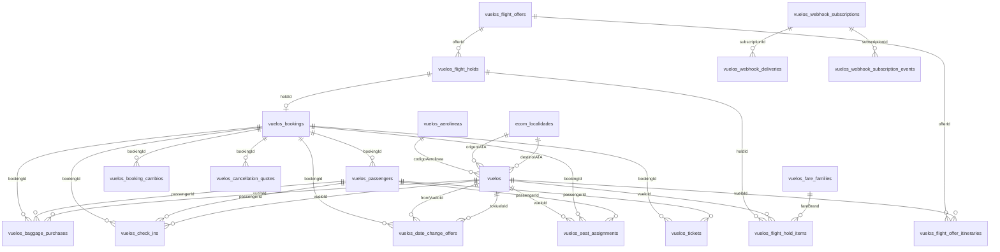
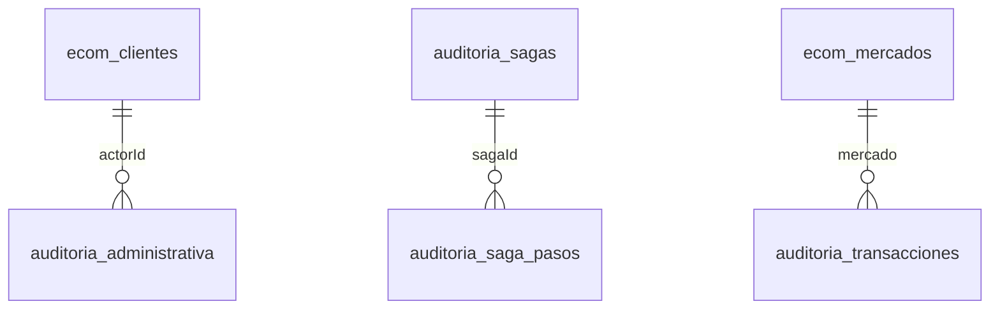

```mermaid
erDiagram
    ecom_ofertas ||--o| ecom_aceptaciones_condiciones : "ofertaId"
    ecom_clientes ||--o{ ecom_cliente_roles : "clienteId"
    ecom_roles ||--o{ ecom_cliente_roles : "rol"
    ecom_mercados ||--o{ ecom_clientes : "mercadoPreferido"
    ecom_facturas ||--o{ ecom_factura_detalles : "facturaId"
    ecom_ordenes ||--o| ecom_facturas : "ordenId"
    ecom_datos_facturacion ||--o{ ecom_facturas : "datosFacturacionId"
    ecom_mercados ||--o{ ecom_mercado_documentos_legales : "mercadoCodigo"
    ecom_mercados ||--o{ ecom_mercado_identificaciones : "mercadoCodigo"
    ecom_mercados ||--o{ ecom_mercado_idiomas : "mercadoCodigo"
    ecom_mercado_medios_pago ||--o{ ecom_mercado_medio_cuotas : "medioId"
    ecom_mercado_medios_pago ||--o{ ecom_mercado_medio_marcas : "medioId"
    ecom_mercado_medios_pago ||--o{ ecom_mercado_medio_productos : "medioId"
    ecom_mercados ||--o{ ecom_mercado_medios_pago : "mercadoCodigo"
    ecom_mercados ||--o{ ecom_mercado_productos : "mercadoCodigo"
    ecom_mercado_reglas ||--o{ ecom_mercado_regla_familias : "reglaId"
    vuelos_fare_families ||--o{ ecom_mercado_regla_familias : "familia"
    ecom_mercados ||--o{ ecom_mercado_reglas : "mercadoCodigo"
    ecom_mercados ||--o{ ecom_notificaciones : "mercado"
    ecom_oferta_pasajeros ||--o{ ecom_oferta_pasajero_asientos : "pasajeroId"
    vuelos ||--o{ ecom_oferta_pasajero_asientos : "vueloId"
    ecom_oferta_pasajeros ||--o{ ecom_oferta_pasajero_necesidades : "pasajeroId"
    ecom_ofertas ||--o{ ecom_oferta_pasajeros : "ofertaId"
    ecom_oferta_trayectos ||--o{ ecom_oferta_trayecto_precios : "trayectoId"
    ecom_ofertas ||--o{ ecom_oferta_trayectos : "ofertaId"
    vuelos ||--o{ ecom_oferta_trayectos : "vueloId"
    vuelos_fare_families ||--o{ ecom_oferta_trayectos : "familia"
    ecom_mercados ||--o{ ecom_ofertas : "mercado"
    vuelos_flight_holds ||--o{ ecom_ofertas : "holdId"
    ecom_datos_facturacion ||--o{ ecom_ofertas : "datosFacturacionId"
    ecom_ordenes ||--o{ ecom_orden_historial : "ordenId"
    ecom_ofertas ||--o| ecom_ordenes : "ofertaId"
    ecom_clientes ||--o{ ecom_ordenes : "clienteId"
    ecom_mercados ||--o{ ecom_ordenes : "mercado"
    vuelos_bookings ||--o| ecom_ordenes : "bookingId"
    ecom_datos_facturacion ||--o{ ecom_ordenes : "datosFacturacionId"
    ecom_pagos ||--o{ ecom_pago_antifraude_motivos : "pagoId"
    ecom_ofertas ||--o{ ecom_pagos : "ofertaId"
    ecom_ordenes ||--o{ ecom_pagos : "ordenId"
    ecom_mercados ||--o{ ecom_pagos : "mercado"
    ecom_mercados ||--o{ ecom_plantillas_notificacion : "mercado"
```

# Modelo de datos — módulo Vuelos

> Generado por `npm run docs:modelo` desde las entidades TypeORM: no se edita a mano.

Esquema **real** de PostgreSQL (56 tablas, 73 llaves foráneas) versionado con migraciones (`src/modules/vuelos/migrations/`). Está en **tercera forma normal**: cada dato vive en una sola tabla, los arreglos y documentos se modelan como tablas hijas y toda relación es una `FOREIGN KEY` real.

Reglas del modelo:

- **Dinero** en unidades menores enteras (`*Minor`, `bigint`); los textos decimales solo existen en la frontera de la API.
- **Sin copias**: la orden no repite el viaje. Sus tramos salen del bloqueo de cupos de la reserva (o de la oferta si nunca se emitió), sus pasajeros de la oferta, su facturación es la fila compartida `ecom_datos_facturacion`.
- **Datos personales cifrados** (AES-256-GCM, prefijo `v1:`) campo por campo: nombres, apellidos, nacimiento, documento, contacto, facturación, cuerpo de notificaciones y secreto de webhook. No se consultan por SQL: se busca por columnas en claro (número de orden, PNR) y el apellido se compara en la aplicación.
- **Sin llave foránea a propósito**: `ownerId` (el `sub` verificado del JWT: cliente o invitado `guest:<id>`, que no es una fila) y las claves de idempotencia. Los documentos opacos (`payload`, `responseBody`, `antes`, `despues`) no son datos relacionales.
- **Integridad que no puede expresar una FK**: el inventario se descuenta con `UPDATE` condicional, la reserva bloquea la fila del hold y la clave única `(vueloId, seatNumber)` impide vender un asiento dos veces.

## 1. Diagrama entidad-relación

Solo relaciones (la columna de la llave foránea va en la etiqueta); las columnas están en el diccionario de la sección 2.

### Núcleo de vuelos (GDS)



### E-commerce R1



### Observabilidad y auditoría



## 2. Diccionario de tablas

### Núcleo de vuelos (GDS)

| Tabla | Para qué sirve | Clave | Columnas | Llaves foráneas (borrado) |
|---|---|---|---|---|
| `vuelos` | Vuelo programado: número, ruta, horario, tarifa base e inventario de asientos | `id` | `codigoAerolinea`, `codigoVuelo`, `origenIATA`, `destinoIATA`, `fechaSalida`, `fechaLlegada`, `precioBase`, `asientosDisponibles`, `capacidadTotal`, `durationMinutes`, `estado` | `codigoAerolinea` → `vuelos_aerolineas` (restringe); `origenIATA` → `ecom_localidades` (restringe); `destinoIATA` → `ecom_localidades` (restringe) |
| `vuelos_aerolineas` | Aerolíneas por código IATA | `codigo` | `nombre` | — |
| `vuelos_baggage_purchases` | Equipaje extra comprado por pasajero y tramo | `id` | `bookingId`, `passengerId`, `itineraryId`, `vueloId`, `quantity`, `unitPriceMinor`, `totalMinor`, `currency`, `paymentReference`, `createdAt` | `bookingId` → `vuelos_bookings` (cascada); `passengerId` → `vuelos_passengers` (cascada); `vueloId` → `vuelos` (restringe) |
| `vuelos_booking_cambios` | Historial de cambios de una reserva (cambio de fecha, reprogramación, cancelación) | `id` | `bookingId`, `cambiadoEn`, `descripcion` | `bookingId` → `vuelos_bookings` (cascada) |
| `vuelos_bookings` | Reserva emitida (PNR) con estado y total | `bookingId` | `pnr`, `holdId`, `status`, `ownerId`, `totalMinor`, `currency`, `paymentReference`, `createdAt`, `updatedAt` | `holdId` → `vuelos_flight_holds` (restringe) |
| `vuelos_cancellation_quotes` | Cotizaciones de cancelación (reembolso y penalidad) | `quoteId` | `bookingId`, `ownerId`, `isRefundable`, `refundMinor`, `penaltyMinor`, `currency`, `status`, `expiresAt`, `createdAt` | `bookingId` → `vuelos_bookings` (cascada) |
| `vuelos_check_ins` | Check-in por pasajero y vuelo con grupo y posición de abordaje | `id` | `bookingId`, `passengerId`, `vueloId`, `seat`, `boardingGroup`, `boardingPosition`, `createdAt` | `bookingId` → `vuelos_bookings` (cascada); `passengerId` → `vuelos_passengers` (cascada); `vueloId` → `vuelos` (restringe) |
| `vuelos_date_change_offers` | Opciones cotizadas de cambio de fecha | `changeOfferId` | `bookingId`, `ownerId`, `itineraryId`, `fromVueloId`, `toVueloId`, `fareDifferenceMinor`, `taxDifferenceMinor`, `changeFeeMinor`, `totalToPayMinor`, `currency`, `status`, `paymentReference`, `expiresAt`, `createdAt` | `bookingId` → `vuelos_bookings` (cascada); `fromVueloId` → `vuelos` (restringe); `toVueloId` → `vuelos` (restringe) |
| `vuelos_fare_families` | Familias tarifarias (BASIC, LIGHT, FULL) | `code` | `name`, `carryOnKg`, `checkedBags`, `changeable`, `refundable`, `seatSelectionIncluded`, `upgradeEligible`, `accrualFactor`, `priceMultiplier` | — |
| `vuelos_flight_hold_items` | Tramos de cada bloqueo: vuelo vigente, asientos, cabina y familia | `id` | `holdId`, `orden`, `itineraryId`, `vueloId`, `seats`, `cabinClass`, `fareBrand` | `holdId` → `vuelos_flight_holds` (cascada); `vueloId` → `vuelos` (restringe); `fareBrand` → `vuelos_fare_families` (restringe) |
| `vuelos_flight_holds` | Bloqueo temporal de cupos con precio congelado | `holdId` | `offerId`, `ownerId`, `status`, `lockedPriceMinor`, `lockedTaxesMinor`, `currency`, `ttlMinutes`, `adults`, `youths`, `children`, `infants`, `createdAt`, `expiresAt` | `offerId` → `vuelos_flight_offers` (restringe) |
| `vuelos_flight_offer_itineraries` | Tramos de cada oferta de búsqueda (id de itinerario → vuelo) | `id` | `offerId`, `orden`, `itineraryId`, `vueloId` | `offerId` → `vuelos_flight_offers` (cascada); `vueloId` → `vuelos` (cascada) |
| `vuelos_flight_offers` | Oferta de búsqueda con precio total y composición del grupo | `offerId` | `grandTotalMinor`, `currency`, `adults`, `youths`, `children`, `infants`, `createdAt`, `expiresAt` | — |
| `vuelos_idempotency_records` | Respuestas guardadas por clave de idempotencia (documento opaco) | `idempotencyKey + route + ownerId` | `requestHash`, `state`, `responseStatus`, `responseBody`, `createdAt` | — |
| `vuelos_passengers` | Pasajeros de la reserva (datos personales cifrados) | `passengerId` | `bookingId`, `clientPassengerId`, `associatedAdultClientId`, `passengerType`, `firstName`, `lastName`, `documentType`, `documentNumber`, `nationality`, `birthDate`, `gender`, `contactEmail`, `contactPhone` | `bookingId` → `vuelos_bookings` (cascada) |
| `vuelos_seat_assignments` | Asientos asignados; la clave única (vuelo, asiento) impide venderlo dos veces | `id` | `vueloId`, `seatNumber`, `bookingId`, `passengerId` | `vueloId` → `vuelos` (restringe); `bookingId` → `vuelos_bookings` (cascada); `passengerId` → `vuelos_passengers` (cascada) |
| `vuelos_tickets` | Billete electrónico por pasajero | `ticketId` | `bookingId`, `passengerId`, `eTicketNumber`, `status`, `issuedAt` | `bookingId` → `vuelos_bookings` (cascada); `passengerId` → `vuelos_passengers` (cascada) |
| `vuelos_webhook_deliveries` | Cola de entregas de webhooks con reintentos | `deliveryId` | `subscriptionId`, `eventId`, `eventType`, `payload`, `status`, `attempts`, `nextAttemptAt`, `lastStatusCode`, `lastError`, `createdAt`, `deliveredAt` | `subscriptionId` → `vuelos_webhook_subscriptions` (cascada) |
| `vuelos_webhook_subscription_events` | Tipos de evento que recibe cada suscripción | `subscriptionId + evento` | — | `subscriptionId` → `vuelos_webhook_subscriptions` (cascada) |
| `vuelos_webhook_subscriptions` | Suscriptores de eventos de reserva (secreto cifrado) | `id` | `ownerId`, `url`, `secret`, `active`, `createdAt` | — |

### E-commerce R1

| Tabla | Para qué sirve | Clave | Columnas | Llaves foráneas (borrado) |
|---|---|---|---|---|
| `ecom_aceptaciones_condiciones` | Versiones de términos aceptadas al comprar | `ofertaId` | `terminos`, `condicionesTransporte`, `aceptadoEn` | `ofertaId` → `ecom_ofertas` (cascada) |
| `ecom_cliente_roles` | Roles de cada cuenta | `clienteId + rol` | — | `clienteId` → `ecom_clientes` (cascada); `rol` → `ecom_roles` (restringe) |
| `ecom_clientes` | Cuentas de cliente (credenciales con hash, bloqueo por intentos) | `clienteId` | `correo`, `correoVerificado`, `hashContrasena`, `nombres`, `apellidos`, `fechaNacimiento`, `telefono`, `numeroSocio`, `mercadoPreferido`, `idiomaPreferido`, `canalNotificacion`, `consentimientoMarketing`, `terminosVersionAceptada`, `terminosAceptadosEn`, `intentosFallidos`, `bloqueadoHasta`, `tokenVerificacionHash`, `tokenVerificacionVenceEn`, `creadoEn`, `actualizadoEn` | `mercadoPreferido` → `ecom_mercados` (restringe) |
| `ecom_datos_facturacion` | Identidad de facturación (cifrada); la comparten oferta, orden y factura | `datosFacturacionId` | `tipoIdentificacion`, `numeroIdentificacion`, `razonSocial`, `direccion`, `pais`, `creadoEn` | — |
| `ecom_factura_detalles` | Líneas de la factura: tramo y tipo de pasajero | `id` | `facturaId`, `linea`, `tipo`, `concepto`, `cantidad`, `precioUnitarioMinor`, `ivaMinor`, `totalMinor` | `facturaId` → `ecom_facturas` (cascada) |
| `ecom_facturas` | Factura de cada orden emitida (subtotal, IVA, total) | `facturaId` | `numeroFactura`, `ordenId`, `datosFacturacionId`, `moneda`, `subtotalMinor`, `ivaMinor`, `totalMinor`, `estado`, `emitidaEn` | `ordenId` → `ecom_ordenes` (restringe); `datosFacturacionId` → `ecom_datos_facturacion` (restringe) |
| `ecom_localidades` | Catálogo de aeropuertos y ciudades por código IATA | `iata` | `ciudad`, `nombre`, `pais`, `paisNombre`, `zonaHoraria`, `ciudadNorm`, `nombreNorm` | — |
| `ecom_mercado_documentos_legales` | Términos, privacidad y condiciones de transporte (versión y URL) | `mercadoCodigo + tipo` | `version`, `url` | `mercadoCodigo` → `ecom_mercados` (cascada) |
| `ecom_mercado_identificaciones` | Tipos de identificación fiscal aceptados y su patrón | `mercadoCodigo + tipo` | `etiqueta`, `patron`, `orden` | `mercadoCodigo` → `ecom_mercados` (cascada) |
| `ecom_mercado_idiomas` | Idiomas del portal por mercado | `mercadoCodigo + idioma` | `orden` | `mercadoCodigo` → `ecom_mercados` (cascada) |
| `ecom_mercado_medio_cuotas` | Planes de cuotas por medio de pago | `medioId + cuotas` | — | `medioId` → `ecom_mercado_medios_pago` (cascada) |
| `ecom_mercado_medio_marcas` | Marcas de tarjeta aceptadas por medio de pago | `medioId + marca` | `orden` | `medioId` → `ecom_mercado_medios_pago` (cascada) |
| `ecom_mercado_medio_productos` | Para qué se puede usar el medio de pago (pasaje, adicional) | `medioId + producto` | — | `medioId` → `ecom_mercado_medios_pago` (cascada) |
| `ecom_mercado_medios_pago` | Medios de pago del mercado | `id` | `mercadoCodigo`, `tipo`, `orden` | `mercadoCodigo` → `ecom_mercados` (cascada) |
| `ecom_mercado_productos` | Pestañas del buscador por mercado | `mercadoCodigo + producto` | `orden` | `mercadoCodigo` → `ecom_mercados` (cascada) |
| `ecom_mercado_regla_familias` | Familias tarifarias a las que aplica el desistimiento | `reglaId + familia` | — | `reglaId` → `ecom_mercado_reglas` (cascada); `familia` → `vuelos_fare_families` (restringe) |
| `ecom_mercado_reglas` | Ventanas regulatorias (retracto, desistimiento, traspaso) | `id` | `mercadoCodigo`, `regla`, `diasHabiles`, `retencionPorcentaje`, `horasAntesDelVuelo`, `maximoPorPasaje`, `maximoPorAnio` | `mercadoCodigo` → `ecom_mercados` (cascada) |
| `ecom_mercados` | Mercado de venta: país, moneda, tipo de cambio, razón social, versión | `codigo` | `pais`, `nombre`, `idiomaPorDefecto`, `moneda`, `tipoCambioDesdeUsd`, `razonSocial`, `activo`, `version`, `actualizadoEn` | — |
| `ecom_notificaciones` | Mensajes enviados con resultado e intentos (cuerpo cifrado) | `notificacionId` | `eventoId`, `tipo`, `canal`, `destinatario`, `mercado`, `idioma`, `plantillaVersion`, `asunto`, `cuerpo`, `referencia`, `estado`, `intentos`, `error`, `creadoEn` | `mercado` → `ecom_mercados` (restringe) |
| `ecom_oferta_pasajero_asientos` | Asientos elegidos por pasajero y vuelo | `id` | `pasajeroId`, `vueloId`, `asiento` | `pasajeroId` → `ecom_oferta_pasajeros` (cascada); `vueloId` → `vuelos` (cascada) |
| `ecom_oferta_pasajero_necesidades` | Necesidades especiales de cada pasajero | `id` | `pasajeroId`, `necesidad` | `pasajeroId` → `ecom_oferta_pasajeros` (cascada) |
| `ecom_oferta_pasajeros` | Pasajeros de la oferta (datos personales cifrados) | `id` | `ofertaId`, `orden`, `idCliente`, `tipo`, `asociadoA`, `nombres`, `apellidos`, `fechaNacimiento`, `genero`, `nacionalidad`, `documentoTipo`, `documentoNumero`, `documentoVencimiento`, `numeroSocio` | `ofertaId` → `ecom_ofertas` (cascada) |
| `ecom_oferta_trayecto_precios` | Precio base e impuestos por tipo de pasajero y tramo | `trayectoId + tipoPasajero` | `baseMinor`, `tasasMinor` | `trayectoId` → `ecom_oferta_trayectos` (cascada) |
| `ecom_oferta_trayectos` | Tramos cotizados de la oferta (vuelo y familia) | `id` | `ofertaId`, `orden`, `vueloId`, `gdsItinerarioId`, `familia`, `totalMinor` | `ofertaId` → `ecom_ofertas` (cascada); `vueloId` → `vuelos` (restringe); `familia` → `vuelos_fare_families` (restringe) |
| `ecom_ofertas` | Oferta de compra: estado, total, grupo, contacto cifrado, bloqueo de cupos | `ofertaId` | `mercado`, `moneda`, `ownerId`, `estado`, `adultos`, `jovenes`, `ninos`, `infantes`, `totalMinor`, `totalPropuestoMinor`, `gdsOfferId`, `holdId`, `venceEn`, `contactoCorreo`, `contactoTelefono`, `datosFacturacionId`, `revalidadaEn`, `enPagoDesde`, `creadaEn`, `actualizadaEn` | `mercado` → `ecom_mercados` (restringe); `holdId` → `vuelos_flight_holds` (restringe); `datosFacturacionId` → `ecom_datos_facturacion` (restringe) |
| `ecom_orden_historial` | Historial de estados de la orden | `id` | `ordenId`, `secuencia`, `estado`, `en`, `motivo` | `ordenId` → `ecom_ordenes` (cascada) |
| `ecom_ordenes` | Orden de compra: número, estado, PNR, reserva, facturación, contacto cifrado | `ordenId` | `numeroOrden`, `ofertaId`, `ownerId`, `clienteId`, `mercado`, `moneda`, `totalMinor`, `estado`, `canal`, `pnr`, `bookingId`, `datosFacturacionId`, `contactoCorreo`, `contactoTelefono`, `creadaEn`, `actualizadaEn` | `ofertaId` → `ecom_ofertas` (restringe); `clienteId` → `ecom_clientes` (restringe); `mercado` → `ecom_mercados` (restringe); `bookingId` → `vuelos_bookings` (restringe); `datosFacturacionId` → `ecom_datos_facturacion` (restringe) |
| `ecom_pago_antifraude_motivos` | Motivos del motor antifraude por pago | `id` | `pagoId`, `motivo` | `pagoId` → `ecom_pagos` (cascada) |
| `ecom_pagos` | Pagos: autorización, captura, anulación y reembolso (monto en unidades menores) | `pagoId` | `ofertaId`, `ordenId`, `ownerId`, `mercado`, `moneda`, `montoMinor`, `reembolsoMinor`, `marca`, `ultimos4`, `cuotas`, `estado`, `autorizacionRef`, `codigoRechazo`, `antifraudeVeredicto`, `antifraudePuntaje`, `claveIdempotencia`, `creadoEn`, `actualizadoEn` | `ofertaId` → `ecom_ofertas` (restringe); `ordenId` → `ecom_ordenes` (restringe); `mercado` → `ecom_mercados` (restringe) |
| `ecom_plantillas_notificacion` | Plantillas versionadas por tipo, mercado e idioma | `plantillaId` | `tipo`, `mercado`, `idioma`, `version`, `asunto`, `cuerpo`, `activa` | `mercado` → `ecom_mercados` (cascada) |
| `ecom_roles` | Catálogo de roles (CUSTOMER, ADMIN) | `codigo` | `descripcion` | — |

### Observabilidad y auditoría

| Tabla | Para qué sirve | Clave | Columnas | Llaves foráneas (borrado) |
|---|---|---|---|---|
| `auditoria_administrativa` | Bitácora de cambios del back-office (antes y después) | `id` | `entidad`, `entidadId`, `actorId`, `accion`, `antes`, `despues`, `creadoEn` | `actorId` → `ecom_clientes` (restringe) |
| `auditoria_saga_pasos` | Pasos de cada saga y su duración | `id` | `sagaId`, `secuencia`, `nombre`, `estado`, `detalle`, `duracionMs`, `en` | `sagaId` → `auditoria_sagas` (cascada) |
| `auditoria_sagas` | Ejecuciones de sagas con su resultado | `sagaId` | `tipo`, `referencia`, `propietarioId`, `correlationId`, `estado`, `error`, `iniciadaEn`, `finalizadaEn` | — |
| `auditoria_transacciones` | Eventos de dominio que pasaron por el bus (solo identificadores) | `id` | `eventoId`, `tipo`, `agregadoId`, `mercado`, `propietarioId`, `correlationId`, `resumen`, `ocurridoEn`, `registradoEn` | `mercado` → `ecom_mercados` (restringe) |
| `peticiones_http` | Muestra acotada del tráfico HTTP (se purga por antigüedad) | `id` | `metodo`, `ruta`, `estado`, `duracionMs`, `correlationId`, `creadaEn` | — |

## 3. Estados principales

- **Reserva** (`vuelos_bookings.status`): `PENDING` → `CONFIRMED` → `CHANGE_PENDING` / `CANCELLATION_PENDING` → `CANCELLED`; `FAILED`.
- **Bloqueo** (`vuelos_flight_holds.status`): `HELD` → `CONSUMED` / `EXPIRED` / `RELEASED`.
- **Oferta** (`ecom_ofertas.estado`): `ABIERTA` → `EN_REVISION_PRECIO` / `EN_PAGO` → `PAGADA`; `VENCIDA`, `CANCELADA`.
- **Orden** (`ecom_ordenes.estado`): `PENDIENTE_PAGO` → `PAGADA` → `EMITIDA` → `MODIFICADA` / `DEVOLUCION_EN_CURSO` → `REEMBOLSADA`; `FALLIDA_COMPENSADA`, `EXPIRADA`. Cada cambio queda en `ecom_orden_historial`.
- **Pago** (`ecom_pagos.estado`): `AUTORIZADO` → `CAPTURADO` → `REEMBOLSADO`; `ANULADO`, `RECHAZADO_*`, y los pendientes que reintenta el reconciliador.
- **Saga** (`auditoria_sagas.estado`): `EN_CURSO` → `COMPLETADA` / `COMPENSADA` / `FALLIDA`.

## 4. Cómo regenerar o comprobar este modelo

```bash
npm run docs:modelo                 # reescribe este archivo desde las entidades
npm run migration:generate:vuelos -- src/modules/vuelos/migrations/NombreCambio   # migración a partir de un cambio de entidad
npm run migration:check:vuelos      # debe salir con código 0 si las migraciones reproducen las entidades
```

Cualquier cambio de entidad exige su migración. La migración `NormalizeSchema` (1792970623866) llevó el esquema anterior (sin llaves foráneas, con arreglos y documentos `jsonb`) a este modelo conservando los datos; es de un solo sentido, así que se hace copia de la base antes de aplicarla.
