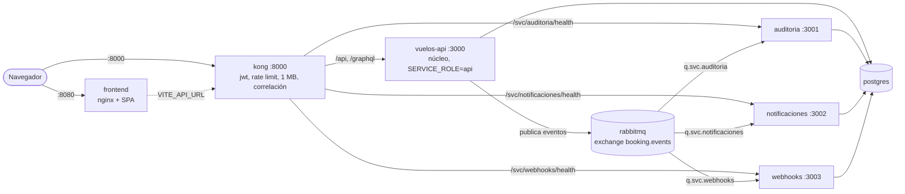

# Contenedores por microservicio (demo local con docker compose)

Antes había **un Dockerfile, una imagen y una Container App** (la app Nest completa). Para el demo hay ahora **un contenedor por microservicio**: el núcleo y tres satélites que consumen los eventos por RabbitMQ, más Kong, el frontend, RabbitMQ y Postgres. **Producción en Azure no cambia**: sigue con la imagen única del `Dockerfile` de la raíz, sin `RABBITMQ_URL`, `SERVICE_ROLE` ni `RABBITMQ_SERVICE_QUEUE` (sin esas variables el proceso es el monolito de siempre, con eventos en memoria).

## Contenedores



| Servicio | Dockerfile | Qué corre | Puerto (contenedor → anfitrión) | Cola |
|---|---|---|---|---|
| `vuelos-api` | `docker/vuelos-api/Dockerfile` | Núcleo: búsqueda, ofertas, holds, reservas, órdenes, pagos, facturación, identidad, admin, API v2 de Booking, GraphQL, stock push. Migra y siembra al arrancar (único dueño del esquema): `npm run start:container` | 3000 (solo dentro de la red; entra por Kong) | colas actuales (`q.ordenes.confirmadas`, `q.sagas.compensacion`, `q.general`, `q.vuelos.entrantes`) |
| `auditoria` | `docker/auditoria/Dockerfile` | `dist/servicios/auditoria/main.js`: eventos → `auditoria_transacciones`, sagas por evento, retención | 3001 → vía Kong `/svc/auditoria/health` | `q.svc.auditoria` |
| `notificaciones` | `docker/notificaciones/Dockerfile` | `dist/servicios/notificaciones/main.js`: eventos de órdenes/cuenta → `ecom_notificaciones` + correo simulado | 3002 → vía Kong `/svc/notificaciones/health` | `q.svc.notificaciones` |
| `webhooks` | `docker/webhooks/Dockerfile` | `dist/servicios/webhooks/main.js`: entregas de webhook y feed `vuelos_outbox`, dispatcher cada 15 s | 3003 → vía Kong `/svc/webhooks/health` | `q.svc.webhooks` |
| `kong` | imagen `kong:3.9` + `deploy/gateway/kong.microservicios.yml` | Puerta única: las reglas de `kong.yml` con upstream `vuelos-api` | 8000 → 8000 | — |
| `frontend` | `docker/frontend/Dockerfile` + `nginx.conf` | Build de Vite servido por nginx (fallback SPA, caché de assets) | 80 → 8080 | — |
| `rabbitmq` | `rabbitmq:3.13-management` | Broker | 5672 → 5673, consola 15672 → 15673 | — |
| `postgres` | `postgres:16` | Base compartida del demo (volumen `pgdata-micro`) | 5432 → 5434 | — |

Los cuatro Dockerfile de backend usan el contexto de la raíz y las mismas etapas de compilación (`npm ci`, `npm run build`), así que BuildKit las reutiliza desde caché; cada uno solo cambia su `CMD`, `EXPOSE` y `HEALTHCHECK`. Los puertos del anfitrión no chocan con `docker-compose.yml` (Postgres 5432/5433) salvo Kong 8000, que también usa el perfil `gateway` de ese archivo: no se levantan a la vez.

## Cómo viaja un evento

1. Una compra termina en el núcleo (una transacción) y `DomainEventBus.publish` entrega el evento al transporte RabbitMQ, que lo publica en el exchange `booking.events` con su clave de enrutamiento.
2. Cada satélite, al arrancar con `RABBITMQ_SERVICE_QUEUE=q.svc.<nombre>`, declara **su propia cola durable** enlazada al exchange con todas las claves: **cada servicio recibe una copia de cada evento**. Si hubiera varias réplicas del mismo servicio, compiten por los mensajes de su cola.
3. El satélite valida el mensaje contra el JSON Schema del evento y corre sus suscriptores (auditoría escribe `auditoria_transacciones`, notificaciones crea el mensaje, webhooks encola las entregas y el feed `vuelos_outbox`).
4. Si un consumidor falla, el mensaje se reintenta (3 veces) y después va a `q.dead_letter`. Los consumidores son idempotentes (auditoría es única por id de evento, el outbox ignora duplicados), así que un reenvío no duplica filas.
5. Si un satélite está caído, el núcleo sigue respondiendo y su cola acumula los mensajes: al volver se procesan los pendientes. (`docker compose ... stop notificaciones`, comprar, `start notificaciones`.)

Con `SERVICE_ROLE=api` el núcleo **no** registra esos suscriptores (los jobs propios del núcleo —holds, reconciliación, stock push— sí corren). Por eso el smoke puede afirmar que la fila de auditoría y la notificación las escribió otro contenedor.

## Por qué el núcleo no se divide

La compra reserva el cupo, crea la reserva y los tiquetes, la orden, la factura y consume el hold **en una sola transacción de base de datos** (`ordenes/compras.service.ts`), con bloqueos de fila y el índice único de asientos como garantía final. Partir hold, reserva, orden, pago y factura en contenedores obligaría a reemplazar esa transacción por sagas con compensaciones entre servicios y a aceptar estados intermedios visibles al cliente: es una reescritura, no un cambio de empaquetado. Lo que sí se separa limpiamente son los consumidores de eventos (auditoría, notificaciones, webhooks), que ya eran asíncronos y tolerantes a fallos.

## Siguiente paso: una base por servicio

Hoy los cuatro backends comparten un Postgres (cada uno escribe solo sus tablas, pero el esquema lo migra el núcleo, por eso los satélites esperan a que `vuelos-api` esté sano). El siguiente paso es una base por satélite: `auditoria_*`, `ecom_notificaciones` y `webhook_*`/`vuelos_outbox` en su propia base, sin lecturas cruzadas desde el núcleo (las pantallas de admin pasarían a consultar al servicio dueño o a una vista replicada). Está descrito en `DESCOMPOSICION-MICROSERVICIOS.md`.

## Cómo levantarlo

```bash
cp docker/.env.microservicios.example docker/.env.microservicios   # valores de demo; el archivo está en .gitignore
npm run micro:build     # construye las 5 imágenes (nucleo, 3 satélites, frontend)
npm run micro:up        # docker compose up -d
npm run micro:smoke     # espera la salud y hace búsqueda + compra de invitado + comprobaciones de auditoría y notificación
npm run micro:logs      # logs en vivo
npm run micro:down      # detiene; con volumen: npm run micro:down -- -v (borra la base del demo)
```

- Web: `http://localhost:8080` (llama a la API por `http://localhost:8000/api/v1`, valor de `VITE_API_URL` incrustado al compilar).
- API y Swagger por la puerta única: `http://localhost:8000/api/docs`. Consola de RabbitMQ: `http://localhost:15673`.
- Administrador de demo: `ADMIN_EMAIL`/`ADMIN_PASSWORD` del `.env.microservicios` (los crea el seed del núcleo). Todos los valores del ejemplo son de demo; nunca use aquí secretos reales.
- La primera subida tarda: el núcleo migra y siembra (el seed corre en segundo plano) y el smoke espera a que existan vuelos.

## Producción

Azure Container Apps sigue desplegando la **imagen única** del `Dockerfile` de la raíz construida por `.github/workflows/container.yml`, con `deploy/azure/*`. Nada de lo de este documento se despliega ni cambia rutas, contratos, `Dockerfile`, workflows ni el `docker-compose.yml` original.
