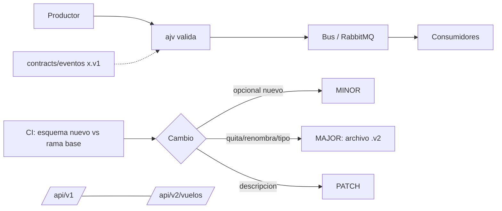
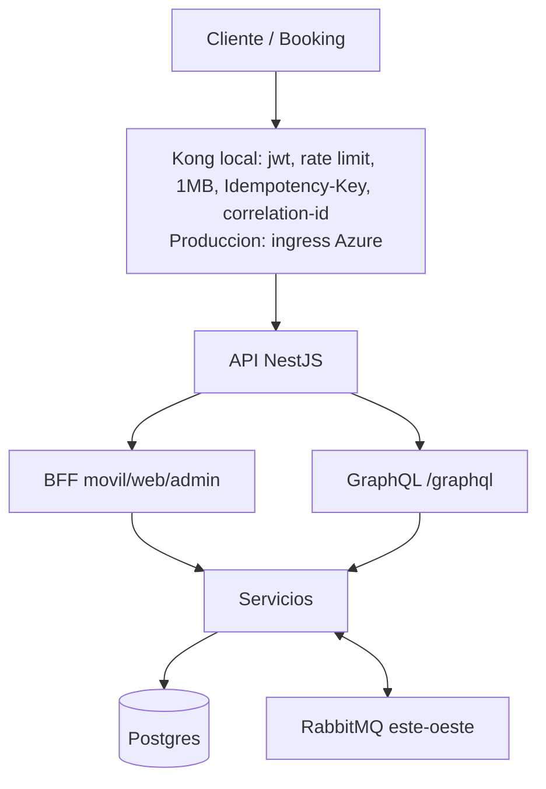
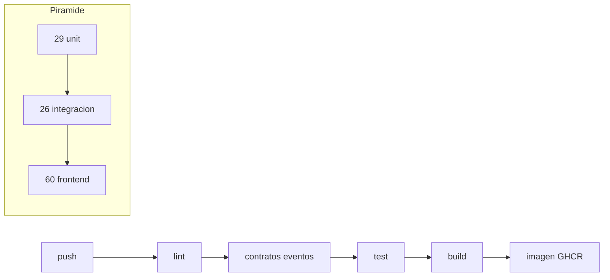
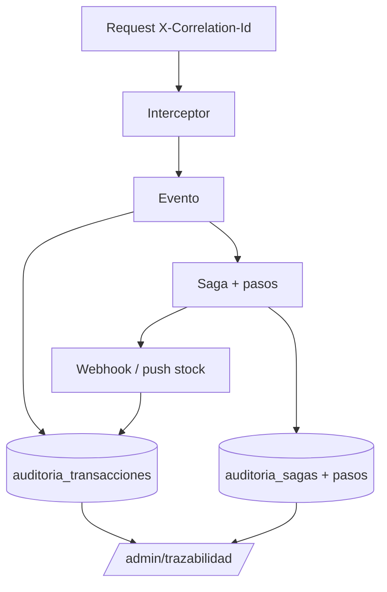
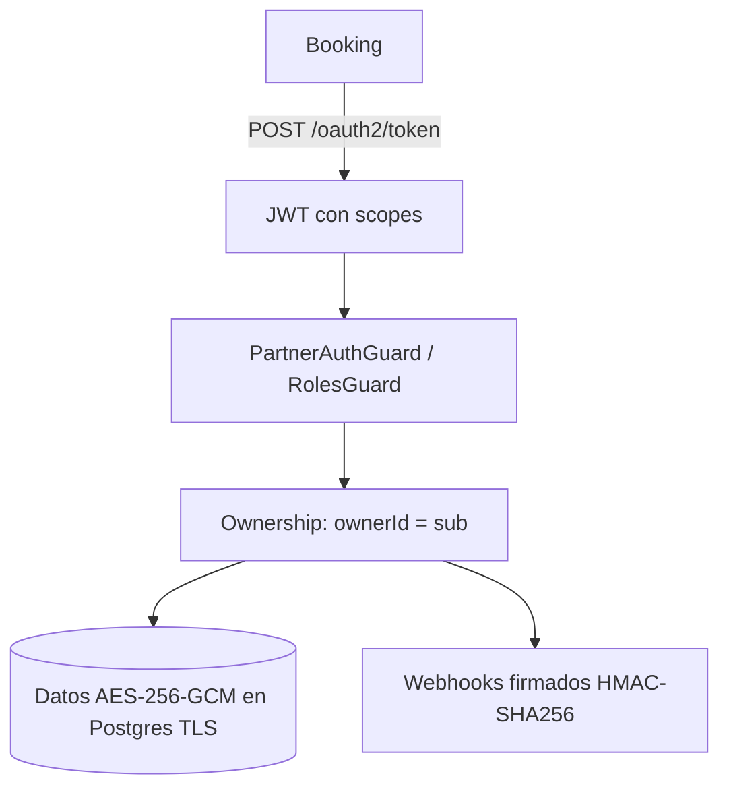

# RETO 2 — RAM Alliance Vuelos (semanas 7-11) — versión corta

Sistema: API NestJS + PostgreSQL (Aiven), RabbitMQ, React; Azure Container Apps (1 réplica).

| Semana | SÍ | Parcial | No |
|---|---|---|---|
| 7 Contratos | OpenAPI, .proto, JSON Schema, ajv, SemVer | Transitividad solo declarada | Avro, Kafka, Registry |
| 8 Gateway | Kong local, BFF, GraphQL, rate limit | Kong solo local | Caching, mesh, canary |
| 9 Pruebas | Unit, integración, contract provider-driven, CI | Sin umbral de cobertura | Pact, Postman, mutation |
| 10 Observabilidad | Logs JSON, correlation-id, auditoría, trazabilidad | Muestreo de peticiones | OpenTelemetry, ELK, SLO |
| 11 Seguridad | OAuth2, JWT, RBAC, AES-256-GCM, HMAC | Menor privilegio; RabbitMQ sin TLS | mTLS, WAF, rotación |

## Semana 7 — Contratos

- **REST vs gRPC:** OpenAPI v1 (22 op.), v2 Booking (30), v2 propio (32); gRPC solo stock · `contracts/vuelos-openapi.yaml`, `src/proto/inventory.proto`
- **Contract-driven:** v2 se genera (plantilla + overlay); un test falla si está obsoleto · `contracts/vuelos-openapi-v2-ram-alliance.yaml`
- **Tipado/catálogo:** TypeScript + DTOs class-validator; carpeta `contracts/`, Swagger `/api/docs` y `/api/docs-v2`.
- **Schema-first / code-first:** schema-first en v1, v2 y eventos; code-first en OpenAPI e-commerce (`npm run contract:export`).
- **JSON Schema:** 39 esquemas, uno por evento, más AsyncAPI · `contracts/eventos/*.v1.schema.json`
- **SemVer:** campo opcional = MINOR; quitar/renombrar/tipo = MAJOR → archivo `.v2` · `docs/RDA2-docs/CONTRATOS-DE-EVENTOS.md`
- **Validación:** ajv por evento; `contract:events:check` en CI, política BACKWARD · `common/event-schemas.ts`, `.github/workflows/ci.yml`
- **No implementado:** versión por fecha (usamos URI), Avro/Kafka (JSON + RabbitMQ), Schema Registry (carpeta en git).

```
Productor --> [ajv valida] --> Bus/RabbitMQ --> Consumidores
                  |                            (auditoría, webhooks, notif.)
          schema contracts/eventos/x.v1
CI: esquema nuevo  vs  esquema rama base
        |-- campo opcional nuevo --> MINOR  (ok)
        |-- quita/renombra/tipo  --> MAJOR  (crear x.v2)
        '-- solo texto/descrip.  --> PATCH
URI: /api/v1 (GDS+web)    /api/v2/vuelos (socios)
```



## Semana 8 — Gateway

- **Gateway:** Kong local: jwt, 300 req/min por IP, 1 MB, Idempotency-Key UUID · `deploy/gateway/kong.yml`
- **Lógica de negocio:** la API hace ownership, penalidades e idempotencia; en producción no hay Kong (ingress Azure).
- **BFF:** `/movil/ordenes`, `/web/ordenes`, `/admin/ordenes/{n}/expediente` · `src/modules/vuelos/ecommerce/bff`
- **Aggregator:** GraphQL `/graphql` (DataLoaders, profundidad máx. 7) · `src/modules/vuelos/gateway`
- **Proxy:** Kong DB-less (YAML) local; nginx solo sirve el frontend · `docker/frontend/nginx.conf`
- **Auth y Zero Trust:** JWT HS256 propio + OAuth2 client_credentials; la API reverifica cada token.
- **Rate limit:** global 300/min, login 20/15 min · `ecommerce/common/global-rate-limit.middleware.ts`. Sin helmet.
- **No implementado:** caching, service mesh (1 réplica; este-oeste = RabbitMQ), canary.

```
Cliente / Booking
      |
[Kong LOCAL: jwt, rate limit, 1MB,
 Idempotency-Key UUID, correlation-id]
 (producción: ingress HTTPS Azure)
      |
 API NestJS --> BFF (/movil /web /admin)
      |     \-> GraphQL /graphql
 Servicios --> Postgres
      |
   RabbitMQ (este-oeste)
```



## Semana 9 — Pruebas

- **Pirámide:** 29 specs unitarios, 26 de integración (Postgres real), 60 de frontend · `testing/integration-app.ts`
- **Herramientas:** Jest 30 + ts-jest + supertest; frontend con Vitest.
- **Contract testing:** provider-driven, respuestas reales contra OpenAPI v2 · `testing/contract-v2-validator.ts`
- **Breaking changes:** `contract-v2-build.spec.ts`, `contract.integration.spec.ts` y `contract:events:check` fallan si hay cambio.
- **Mocking:** `jest.fn` y servidores falsos de Booking/socios; lo crítico con BD real · `testing/partner-falso.ts`
- **CI/CD:** lint, contratos, test, build, Postgres 16; imagen a GHCR · `.github/workflows/ci.yml`
- **No implementado:** Pact, Postman, snapshot, mutation; `test:cov` sin umbral.

```
        /\   E2E (no)
       /60\  frontend Vitest
      /----\
     / 26   \ integración (Postgres real)
    /--------\
   /   29     \ unitarias
  /------------\
push -> lint -> contratos eventos -> test -> build -> imagen GHCR
         (si falla alguno, se detiene)
```



## Semana 10 — Observabilidad

- **Logs y métricas:** winston JSON con correlationId; métricas por ruta (se reinician) · `common/winston-logger.ts`, `common/runtime-metrics.ts`
- **Muestreo:** `peticiones_http` guarda muestra con retención de 7 días.
- **Correlación:** `X-Correlation-Id` propio hacia eventos, sagas, webhooks y stock · `common/correlation.ts`
- **Trazabilidad:** tablas de auditoría y `/admin/trazabilidad` · `ecommerce/admin/trazabilidad.service.ts`
- **Resiliencia:** circuit breaker opossum (50 % error); webhooks reintentan 1 m/5 m/30 m/2 h/6 h.
- **Saga:** REVALIDAR_PRECIO → AUTORIZAR_PAGO → EMITIR_ORDEN → CAPTURAR_PAGO → ANUNCIAR_EMISION; falla: ANULAR_PAGO · `ecommerce/ordenes/compras.service.ts`
- **No implementado:** OpenTelemetry, Jaeger, ELK, Grafana; SLO, SLI, error budget, Apdex, percentiles.

```
Request (X-Correlation-Id)
   |
Interceptor --> guarda id en contexto
   |
Evento --> Saga (pasos) --> Webhook / push stock
   |          |                 |
   v          v                 v
auditoria_  auditoria_sagas  llamada.* / webhook.*
transacciones (+pasos)    (auditoria_transacciones)
        \        |        /
         /admin/trazabilidad (línea de tiempo + flujo)
```



## Semana 11 — Seguridad

- **OAuth2:** `client_credentials` en `POST /api/v2/oauth2/token`; scopes flights:read, hold, book, cancel, webhooks, ops, admin · `v2/auth/scopes.ts`
- **JWT:** HS256 (no RSA), issuer `vuelos-identity`, secreto ≥ 32 caracteres, TTL 3600 s · `auth/token.service.ts`
- **Autorización:** JwtAuthGuard/PartnerAuthGuard, RolesGuard, `@RequiresScope`; `ownerId` = `sub` · `auth/roles.guard.ts`
- **Menor privilegio:** parcial; el cliente de Booking recibe todos los scopes por defecto.
- **TLS:** Postgres Aiven con CA propia (`DB_SSL_CA`), ingress HTTPS; Kong local HTTP · `common/db-ssl.ts`
- **Cifrado/hash:** AES-256-GCM datos personales; scrypt contraseñas; HMAC-SHA256 QR y webhooks · `common/cifrado.ts`
- **Mensajería:** RabbitMQ con usuario/contraseña, sin TLS; `q.dead_letter` tras 3 reintentos · `esb/rabbitmq.transport.ts`
- **OWASP:** BOLA 404, whitelist DTO, rate limit, SSRF `common/safe-http.ts`, CORS lista blanca, sin helmet.
- **No implementado:** mTLS, WAF, rotación de claves (cambiar `JWT_SECRET` invalida los QR).

```
Booking --POST /oauth2/token--> JWT con scopes
   |
   v
PartnerAuthGuard / RolesGuard  (scope / rol)
   |
Ownership (ownerId = sub)
   |
Servicio --> datos cifrados AES-256-GCM --> Postgres (TLS, CA propia)
Webhooks salientes: firma HMAC-SHA256
```



## Qué NO tengo y cómo decirlo

- Avro/Kafka/Registry: «Usamos JSON Schema + RabbitMQ, registro en carpeta versionada con CI.»
- Pact/Postman: «Hacemos contract testing provider-driven contra el OpenAPI.»
- Mesh/canary/OpenTelemetry/ELK: «Con una réplica no se justifica; trazabilidad propia con correlation-id.»
- SLO/SLI, mTLS, WAF, rotación: «No implementados; usamos JWT, scopes, HMAC y TLS a la base.»
- RabbitMQ sin TLS y Kong solo local: «Producción usa ingress Azure; TLS en RabbitMQ es mejora.»
