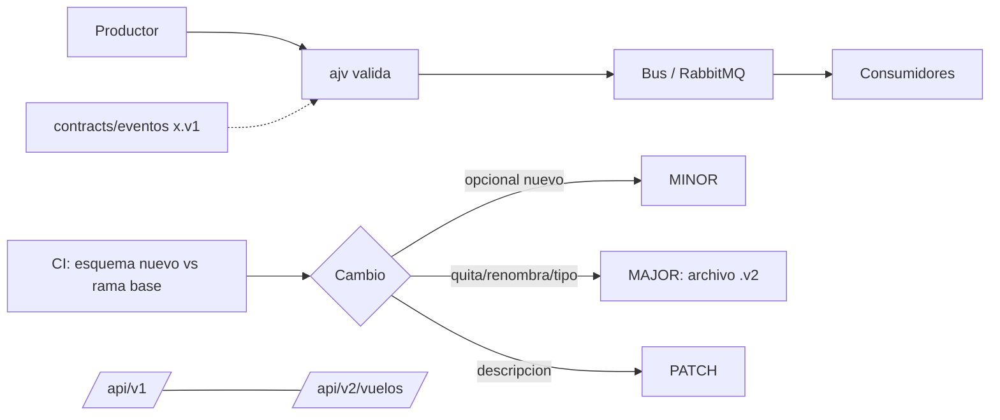
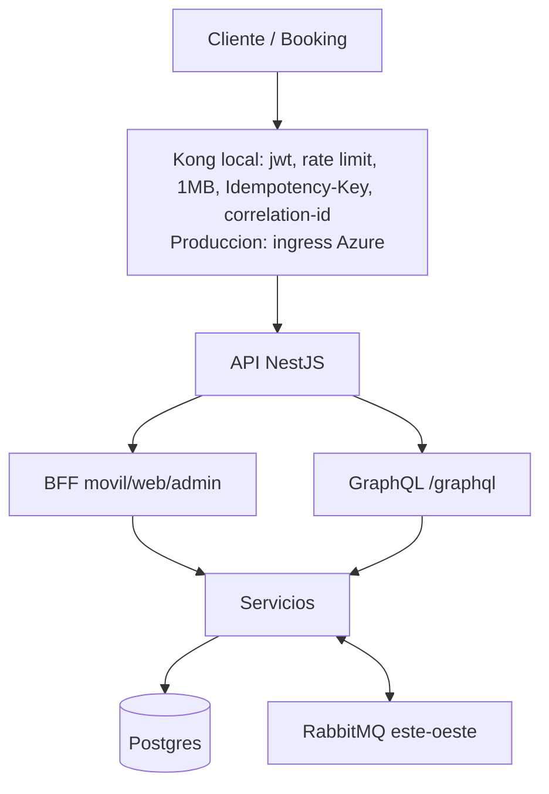
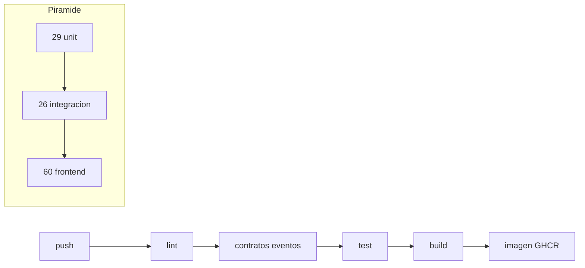
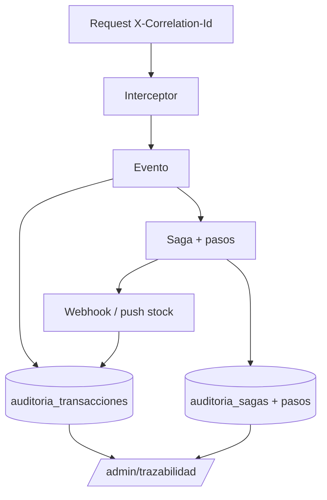
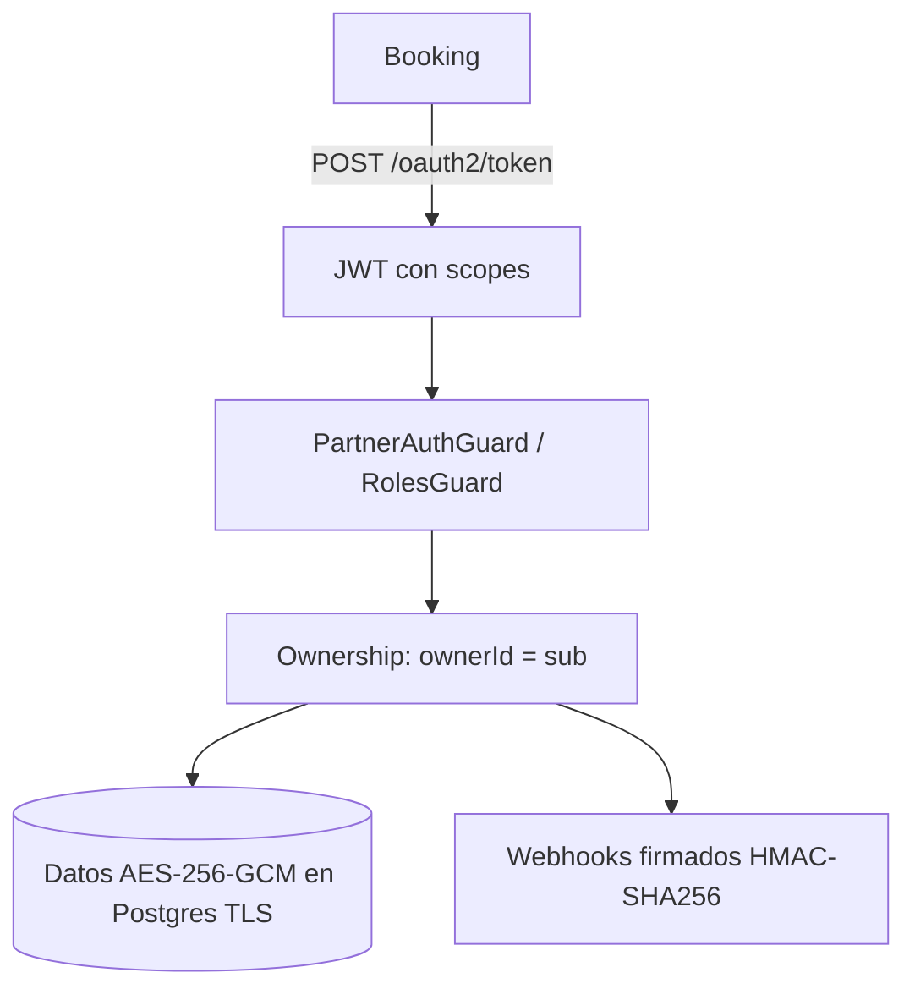

# RETO 2 — Integración de Sistemas aplicada a RAM Alliance Vuelos (semanas 7-11)

**Cómo usar:** copia cada viñeta: concepto corto + «En mi sistema». Los diagramas se dibujan a mano (ASCII). «No implementado» = dilo así, con lo que usamos en su lugar.
Sistema: API NestJS + PostgreSQL (Aiven), RabbitMQ, frontend React; despliegue en Azure Container Apps (máximo 1 réplica, escala a cero).

| Semana | Lo que SÍ tengo | Parcial | No tengo |
|---|---|---|---|
| 7 Contratos | OpenAPI v1/v2, .proto, 39 JSON Schema, ajv, SemVer, CI de compatibilidad | Transitividad solo declarada | Avro, Kafka, Schema Registry, versión por fecha |
| 8 Gateway | Kong local, BFF, GraphQL (aggregator), rate limit, OWASP básico | Kong solo local; sin helmet | Caching, service mesh, canary |
| 9 Pruebas | Unit + integración (Postgres real) + frontend, contract test provider-driven, CI | Sin umbral de cobertura | Pact, Postman, snapshot, mutation |
| 10 Observabilidad | Logs JSON, métricas, correlation-id, auditoría, saga, trazabilidad propia | Muestreo de peticiones | OpenTelemetry, Jaeger, ELK, Grafana, SLO |
| 11 Seguridad | OAuth2, JWT, scopes, RBAC, AES-256-GCM, HMAC, TLS a la BD | Menor privilegio parcial; RabbitMQ sin TLS | mTLS, WAF, rotación de claves |

## Semana 7 — Esquemas, compatibilidad y gestión de contratos

- **Contratos REST vs gRPC:** contrato = acuerdo escrito de entradas/salidas; REST usa OpenAPI, gRPC usa .proto → **En mi sistema:** REST con OpenAPI v1 (22 op.), v2 plantilla de Booking (30) y v2 propio (32); gRPC solo para enviar stock a Booking · `contracts/vuelos-openapi.yaml`, `src/proto/inventory.proto`
- **Contrato implícito → contract-driven:** primero se acuerda el contrato, luego el código → **En mi sistema:** el v2 se genera (plantilla + overlay) y el OpenAPI e-commerce se exporta del código; un test falla si están obsoletos · `contracts/vuelos-openapi-v2-ram-alliance.yaml`
- **Tipado fuerte vs débil:** fuerte valida tipos al compilar/ejecutar → **En mi sistema:** TypeScript + DTOs class-validator (ValidationPipe whitelist + forbidNonWhitelisted); .proto con 4 mensajes tipados.
- **Catálogos de contratos:** lugar único donde viven los contratos → **En mi sistema:** carpeta `contracts/` (REST, eventos, socios) y Swagger en `/api/docs` y `/api/docs-v2`.
- **Schema-first vs code-first:** diseñar el esquema antes del código o generarlo desde el código → **En mi sistema:** schema-first en v1, v2 y eventos; code-first en el OpenAPI e-commerce (se exporta con `npm run contract:export`). Riesgo: el YAML se desactualiza, por eso hay tests.
- **Stripe versionado por fecha:** versiones por fecha de la API → **No implementado:** versionamos por URI `/api/v1` y `/api/v2/vuelos`.
- **JSON Schema (allOf/oneOf/anyOf/not):** vocabulario para describir y validar JSON → **En mi sistema:** 39 JSON Schema, uno por evento, más AsyncAPI · `contracts/eventos/*.v1.schema.json`, `contracts/vuelos-eventos-asyncapi.yaml`
- **Avro y Protobuf:** formatos binarios con esquema; Avro típico con Kafka → **En mi sistema:** Protobuf sí (stock); **No implementado** Avro ni Kafka: usamos JSON + RabbitMQ.
- **Evolución de Protobuf:** campos con número; añadir es compatible → **En mi sistema:** `inventory.proto` (InventoryStockService, 2 rpc); no ha cambiado.
- **Schema Registry:** servicio central de esquemas versionados → **No implementado:** el «registro» es la carpeta versionada en git + RabbitMQ.
- **SemVer MAJOR/MINOR/PATCH:** MAJOR rompe, MINOR añade, PATCH corrige → **En mi sistema:** campo opcional nuevo = MINOR; quitar/renombrar/cambiar tipo/requerido nuevo = MAJOR → archivo `.v2` · `docs/RDA2-docs/CONTRATOS-DE-EVENTOS.md`
- **Niveles NONE/BACKWARD/FORWARD/FULL (+transitivas):** quién puede leer qué versión → **En mi sistema:** política declarada BACKWARD; el script compara con la rama base, no con todas las versiones (transitividad solo declarada).
- **Validación automática y backward compatibility:** detectar cambios que rompen antes de publicar → **En mi sistema:** ajv valida cada evento (strict fuera de producción, warn en producción) y `contract:events:check` corre en CI · `common/event-schemas.ts`, `scripts/check-schema-compat.ts`, `.github/workflows/ci.yml`

```
Productor --> [ajv valida] --> Bus/RabbitMQ --> Consumidores
                  |                            (auditoría, webhooks, notif.)
          schema contracts/eventos/x.v1
CI: esquema nuevo  vs  esquema rama base
        |-- campo opcional nuevo --> MINOR  (ok)
        |-- quita/renombra/tipo  --> MAJOR  (crear x.v2)
        '-- solo texto/descrip.  --> PATCH
URI: /api/v1 (GDS+web)    /api/v2/vuelos (socios)
```



## Semana 8 — API Gateways y Service Mesh

- **Funciones del Gateway (qué hace y qué NO):** puerta única: auth, límites, enrutado; no lleva la lógica de negocio → **En mi sistema:** Kong local hace jwt, 300 req/min por IP, 1 MB, UUID de Idempotency-Key, correlation-id; la API hace ownership, penalidades e idempotencia · `deploy/gateway/kong.yml`
- **Zuul → Kong; caching:** gateways históricos y de hoy; caché de respuestas en el borde → **No implementado** caching en gateway.
- **BFF:** una API por tipo de cliente → **En mi sistema:** `/movil/ordenes`, `/web/ordenes`, `/admin/ordenes/{n}/expediente` · `src/modules/vuelos/ecommerce/bff`
- **Aggregator:** une varias fuentes en una respuesta → **En mi sistema:** gateway GraphQL `/graphql` (DataLoaders, profundidad máx. 7) · `src/modules/vuelos/gateway`
- **Proxy:** intermediario que reenvía → **En mi sistema:** Kong (local) / ingress de Azure Container Apps (producción); nginx solo sirve el frontend · `docker/frontend/nginx.conf`
- **Kong, Apigee o Nginx (DB-less vs con base; plugins):** → **En mi sistema:** Kong DB-less (config en un YAML), solo local; en producción **no hay Kong**.
- **Istio y Linkerd (norte-sur vs este-oeste; sidecar/Envoy):** service mesh para tráfico interno → **No implementado:** norte-sur = ingress → API; este-oeste = RabbitMQ y llamadas en proceso; con 1 réplica no se necesita.
- **JWT vs API Key en el borde:** JWT identifica usuario; API Key identifica app → **En mi sistema:** JWT HS256 propio + OAuth2 client_credentials para socios; x-api-key solo saliente hacia Booking (stock).
- **OWASP API Top 10 / Zero Trust:** nunca confiar en el borde → **En mi sistema:** la API vuelve a verificar cada token aunque pase por Kong.
- **Canary por rutas:** probar versión nueva con poco tráfico → **No implementado.**
- **Gobernanza y rate limiting:** → **En mi sistema:** límite global 300/min, login 20/15 min (en memoria por proceso) · `ecommerce/common/global-rate-limit.middleware.ts`. Pendiente: Swagger público en producción, sin helmet.

```
Cliente / Booking
      |
[Kong LOCAL: jwt, rate limit, 1MB,
 Idempotency-Key UUID, correlation-id]
 (producción: ingress HTTPS Azure)
      |
 API NestJS --> BFF (/movil /web /admin)
      |     \-> GraphQL /graphql
 Servicios --> Postgres
      |
   RabbitMQ (este-oeste)
```



## Semana 9 — Pruebas de integración y contract testing

- **Unitarias, integración y E2E (pirámide):** muchas unitarias, menos integración, pocas E2E → **En mi sistema:** 29 specs unitarios, 26 de integración (Postgres real, un esquema por suite), 60 archivos de frontend (Vitest); ≈550 pruebas backend y 367 frontend · `testing/integration-app.ts`
- **Jest/supertest:** → **En mi sistema:** Jest 30 + ts-jest + supertest.
- **Snapshot, TDD, cobertura:** → **No implementado** snapshot; no afirmo TDD; existe `test:cov` pero sin umbral y CI no lo usa.
- **Contract testing (Pact y Postman; consumer vs provider-driven):** → **No usamos Pact ni Postman;** hacemos contract testing provider-driven: las respuestas reales se validan contra el OpenAPI v2 · `testing/contract-v2-validator.ts`, `testing/contract-v2.integration.spec.ts`
- **Breaking changes antes del despliegue (Pact Broker/can-i-deploy):** → **En mi sistema:** `contract-v2-build.spec.ts` falla si el YAML está obsoleto; `contract.integration.spec.ts` falla si cambia una ruta; `contract:events:check` en CI. Sin Pact Broker.
- **Mocking (test doubles; mocks HTTP externos; exceso):** → **En mi sistema:** `jest.fn` (74 usos) y servidores falsos HTTP/gRPC de Booking y de socios · `testing/partner-falso.ts`, `testing/stock-http.integration.spec.ts`, `testing/stock-grpc.integration.spec.ts`. Lo crítico se prueba con BD real, no con mocks.
- **Pruebas en CI/CD (workflow, gates):** → **En mi sistema:** jobs backend (lint, contratos de eventos, test, build, Postgres 16) y frontend (lint, test, build); si algo falla no pasa · `.github/workflows/ci.yml`; imagen a GHCR en `container.yml`.
- **Publicación de Pact; mutation testing:** → **No implementado.**

```
        /\   E2E (no)
       /60\  frontend Vitest
      /----\
     / 26   \ integración (Postgres real)
    /--------\
   /   29     \ unitarias
  /------------\
push -> lint -> contratos eventos -> test -> build -> imagen GHCR
         (si falla alguno, se detiene)
```



## Semana 10 — Observabilidad y trazas distribuidas

- **Logs, métricas y trazas (3 pilares; monitoreo vs observabilidad; sampling):** monitoreo = ver si falla; observabilidad = entender por qué → **En mi sistema:** logs JSON (winston, rotación 10 MB×5, correlationId en cada línea) y métricas por ruta (requests, errores, promedio, máximo; se reinician) · `common/winston-logger.ts`, `common/runtime-metrics.ts`. Muestreo: `peticiones_http` guarda una muestra con retención de 7 días.
- **OpenTelemetry (spans, propagación de contexto, tracing.ts):** → **No implementado;** propagamos nuestro propio `X-Correlation-Id` (aceptado o generado, devuelto, copiado a eventos, sagas, webhooks y push de stock) · `common/correlation.ts`
- **Jaeger + ELK + Grafana/Prometheus:** → **No implementado;** usamos las tablas de auditoría y la pantalla `/admin/trazabilidad` (flujo por nodos) · `ecommerce/admin/trazabilidad.service.ts`
- **KPIs de integración (latencia, throughput, SLO/SLI, error budget, burn rate, Apdex):** → Latencia promedio/máxima y conteos en `/admin/observabilidad/runtime` y `/resumen`. **No definidos:** SLO, SLI, error budget, burn rate, Apdex ni percentiles.
- **Correlación y debugging distribuido (trace_id, cuello de botella, cascada):** → **En mi sistema:** un correlation-id une request, eventos, saga y webhooks; circuit breaker opossum (50 % error, mín. 3) corta cascadas; webhooks reintentan 1 m/5 m/30 m/2 h/6 h.
- **Saga de pedidos e incidente:** → Saga de compra: REVALIDAR_PRECIO → AUTORIZAR_PAGO → EMITIR_ORDEN → CAPTURAR_PAGO → ANUNCIAR_EMISION; si falla: ANULAR_PAGO → REGISTRAR_ORDEN_FALLIDA · `ecommerce/ordenes/compras.service.ts`

```
Request (X-Correlation-Id)
   |
Interceptor --> guarda id en contexto
   |
Evento --> Saga (pasos) --> Webhook / push stock
   |          |                 |
   v          v                 v
auditoria_  auditoria_sagas  llamada.* / webhook.*
transacciones (+pasos)    (auditoria_transacciones)
        \        |        /
         /admin/trazabilidad (línea de tiempo + flujo)
```



## Semana 11 — Seguridad en integraciones

- **OAuth2 (grant types) y scopes:** → **En mi sistema:** `client_credentials` para socios en `POST /api/v2/oauth2/token`; scopes flights:read, hold, book, cancel, webhooks, ops, admin (admin vale por todos); hash señuelo contra enumeración · `v2/auth/partner-auth.service.ts`, `v2/auth/scopes.ts`
- **JWT (anatomía) y HMAC vs RSA:** header.payload.firma → **En mi sistema:** HS256 (HMAC simétrico, no RSA), issuer `vuelos-identity`, algoritmo fijado, secreto ≥ 32 caracteres, TTL 3600 s · `auth/token.service.ts`
- **mTLS:** → **No implementado.**
- **RBAC/ABAC; autenticación vs autorización:** autenticar = quién eres; autorizar = qué puedes → **En mi sistema:** autenticación JwtAuthGuard/PartnerAuthGuard; autorización RolesGuard (`@Roles`) y `@RequiresScope`; ABAC por propiedad: `ownerId` = `sub` verificado (404 si ajeno en v2, 403 en v1) · `auth/jwt-auth.guard.ts`, `auth/roles.guard.ts`
- **Guards/decoradores NestJS; menor privilegio:** → Guards y decoradores usados en 17 archivos. Parcial: el cliente de Booking recibe todos los scopes por defecto.
- **WAF y Zero Trust:** → **No implementado WAF;** Zero Trust sí: la API verifica cada token tras el borde.
- **Cifrado TLS (CA propia):** → **En mi sistema:** Postgres Aiven con CA propia (`DB_SSL_CA`) e ingress HTTPS de Azure; Kong local usa HTTP · `common/db-ssl.ts`
- **Cifrado vs hashing:** cifrar es reversible, hash no → **En mi sistema:** AES-256-GCM para datos personales (`common/cifrado.ts`); scrypt para contraseñas; SHA-256 para tokens de verificación; blind index HMAC para documentos; QR y webhooks firmados con HMAC-SHA256.
- **Rotación de claves:** → **No implementado procedimiento:** `DATA_ENCRYPTION_KEY` no se rota con datos existentes; cambiar `JWT_SECRET` invalida los QR.
- **Seguridad en colas/mensajería y auditoría de eventos:** → **En mi sistema:** RabbitMQ con usuario/contraseña, **sin TLS** (amqp://), cola por servicio y `q.dead_letter` tras 3 reintentos · `esb/rabbitmq.transport.ts`. Auditoría con correlation-id, ip, user agent y actor · `ecommerce/observabilidad/`
- **OWASP API Top 10 aplicado:** API1 BOLA: orden ajena → 404 (`ordenes.service.ts`) · API2 autenticación: JWT + login 20/15 min · API3 mass assignment: whitelist DTO · API4 recursos: rate limit 300/min · API5 función: `@Roles`/`@RequiresScope` · API6 flujos sensibles: Idempotency-Key + saga · API7 SSRF: `common/safe-http.ts` · API8 configuración: CORS lista blanca, config validada al arrancar, errores sin stack (`common/problem-details.filter.ts`); sin helmet · API9 inventario: contratos generados y validados · API10 APIs externas: circuit breaker + firma + ajv.

```
Booking --POST /oauth2/token--> JWT con scopes
   |
   v
PartnerAuthGuard / RolesGuard  (scope / rol)
   |
Ownership (ownerId = sub)
   |
Servicio --> datos cifrados AES-256-GCM --> Postgres (TLS, CA propia)
Webhooks salientes: firma HMAC-SHA256
```



## Qué NO tengo y cómo decirlo

- Avro / Kafka / Schema Registry: «Usamos JSON Schema + RabbitMQ y un registro en carpeta versionada con chequeo en CI.»
- Pact / Postman: «No usamos Pact; hacemos contract testing provider-driven validando contra el OpenAPI.»
- Service mesh y canary: «Con una sola réplica no se justifica; el borde es el ingress de Azure.»
- OpenTelemetry / Jaeger / ELK / Grafana: «Implementamos trazabilidad propia con correlation-id y tablas de auditoría.»
- SLO/SLI/error budget: «Medimos latencia y errores, pero no hemos definido objetivos formales.»
- mTLS, WAF, helmet, rotación de claves: «No implementados; usamos JWT, scopes, HMAC y TLS hacia la base.»
- RabbitMQ sin TLS: «Con usuario/contraseña; TLS queda como mejora.»
- Kong en producción: «Solo local; producción usa el ingress de Azure y la API verifica todo.»
